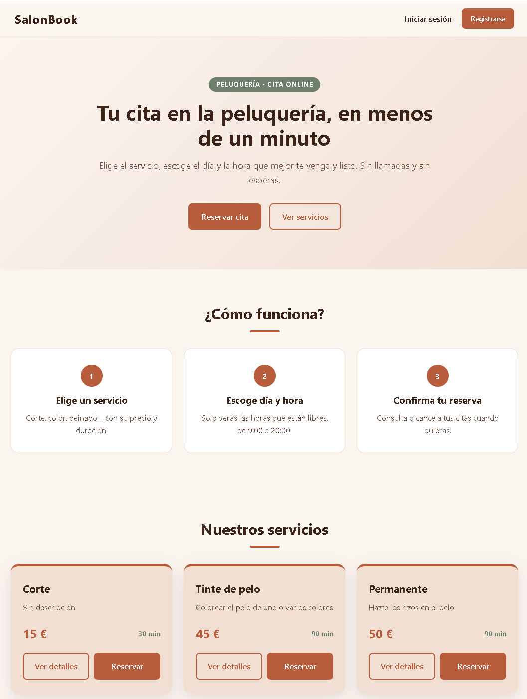
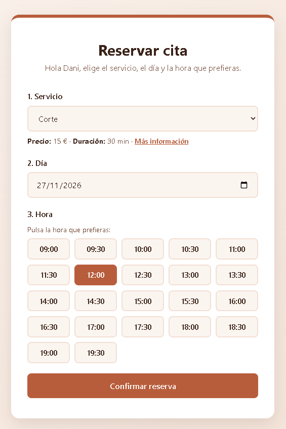
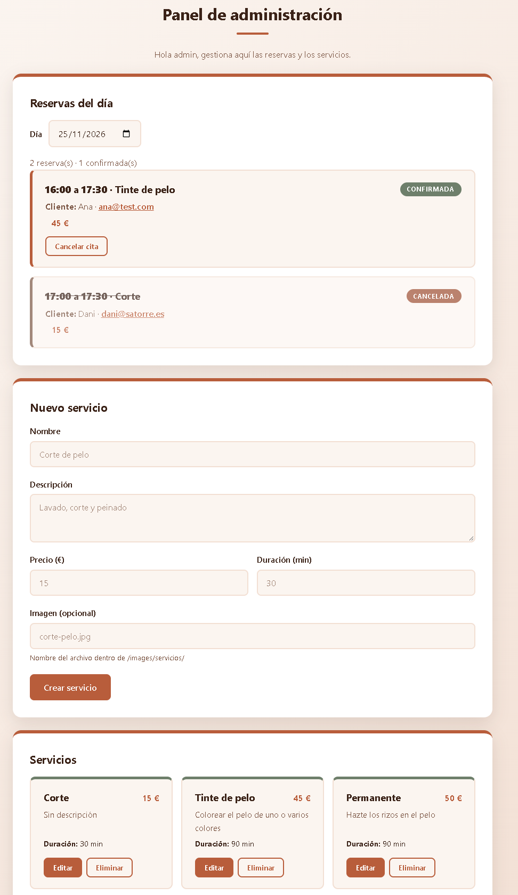

# SalonBook

Aplicación web de **reservas para una peluquería**. Los clientes pueden consultar los servicios del salón (nombre, descripción, precio y duración), elegir un día y una hora libre y reservar su cita. Desde su perfil pueden ver sus reservas y cancelarlas.

La peluquería dispone de un **panel de administración** desde el que puede ver las reservas de cada día, cancelarlas y crear, editar o borrar los servicios que ofrece.

Las citas se organizan en franjas de 30 minutos, de 9:00 a 20:00. Una hora solo se puede reservar si no se solapa con otra reserva activa.







### Tecnologías

- **Backend:** Node.js + Express, MongoDB con Mongoose
- **Autenticación:** JWT (`jsonwebtoken`) y contraseñas cifradas con `bcrypt`
- **Frontend:** HTML, CSS y JavaScript
- **Base de datos:** MongoDB en Docker (`docker-compose.yaml`)

---

## Puesta en marcha

### Requisitos previos

- [Node.js](https://nodejs.org/) 18 o superior
- [Docker](https://www.docker.com/) con Docker Compose
- Git

### 1. Clonar el repositorio e instalar dependencias

```bash
git clone https://github.com/danisatorre/salonbook.git
cd salonbook
npm install
```

### 2. Configurar las variables de entorno

Copia el archivo de ejemplo y rellena los valores:

```bash
cp .env.example .env
```

| Variable         | Descripción                                   | Ejemplo                                      |
| ---------------- | --------------------------------------------- | -------------------------------------------- |
| `PORT`           | Puerto en el que se levanta el servidor       | `3000`                                       |
| `MONGO_USER`     | Usuario de MongoDB                            | `admin`                                      |
| `MONGO_PASSWORD` | Contraseña de MongoDB                         | `contraseña de admin de MongoDB`             |
| `MONGODB_URL`    | Host, puerto y base de datos de MongoDB       | `localhost:27017/salonbook?authSource=admin` |
| `JWT_SECRET`     | Clave secreta para firmar los tokens JWT      | `una_cadena_larga_y_aleatoria`               |
| `BASE_PATH`      | *(Opcional)* Prefijo de la URL si la web se publica en una subruta, p. ej. detrás de Apache. Vacío en local | `/salonbook`                                 |

> `MONGO_USER` y `MONGO_PASSWORD` los usa tanto Docker (para crear el usuario de MongoDB) como la web (para conectarse), así que deben ser los mismos.

### 3. Levantar MongoDB con Docker

```bash
docker compose up -d
```

Esto crea el contenedor `mongodb_salonbook` en el puerto `27017`. Los datos se guardan en un volumen, así que no se pierden al parar el contenedor.

Para pararlo:

```bash
docker compose down
```

### 4. Arrancar la aplicación

Hay dos formas de arrancar el servidor según lo que se quiera hacer:

#### Modo desarrollo (para hacer cambios)

```bash
npm run dev
```

Arranca el servidor con `node --watch`, que **lo reinicia automáticamente cada vez que se guarda un archivo**.

#### Modo normal (solo para usar la aplicación)

```bash
npm start
```

Arranca el servidor con `node index.js` sin vigilar los archivos. Es el modo para tener la aplicación abierta sin modificar nada.

En los dos casos, si todo va bien, la consola mostrará:

```
Servidor alojado en http://localhost:3000
Conectado a MongoDB en localhost:27017/salonbook?authSource=admin
```

La aplicación estará disponible en **http://localhost:3000** *(o el puerto que indiques en el .env)*.

> Si MongoDB no está levantado, el servidor muestra `ERROR: No se ha podido conectar a MongoDB` y se detiene.

### 5. Crear un usuario administrador

Todos los usuarios que se registran desde la web tienen el rol `cliente`. Para tener un administrador, registra un usuario normal desde la web y después cambia su rol en MongoDB:

```bash
docker exec -it mongodb_salonbook mongosh -u <MONGO_USER> -p <MONGO_PASSWORD> --authenticationDatabase admin salonbook
```

```js
db.usuarios.updateOne({ email: 'admin@test.com' }, { $set: { rol: 'admin' } })
```

Al volver a iniciar sesión con ese usuario se podrá acceder a `/admin`.

---

## Páginas de la aplicación

| Ruta             | Página                                  |
| ---------------- | --------------------------------------- |
| `/`              | Inicio y listado de servicios           |
| `/servicios/:id` | Detalle de un servicio                  |
| `/login`         | Inicio de sesión                        |
| `/register`      | Registro de usuario                     |
| `/reservas`      | Reservar una cita                       |
| `/mis-reservas`  | Reservas del cliente                    |
| `/admin`         | Panel de administración (solo admin)    |

## API

| Prefijo          | Descripción                     |
| ---------------- | ------------------------------- |
| `/api/auth`      | Registro e inicio de sesión     |
| `/api/servicios` | Gestión de servicios            |
| `/api/reservas`  | Gestión de reservas             |

Las rutas que hacen cambios importantes necesitan la cabecera `Authorization: Bearer <token>`, con el token que devuelve el login.

## ACCEDER AL PROYECTO DESPLEGADO 
Para acceder al proyecto en el lugar en el que lo tengo desplegado hay que acceder desde un navegador a la siguiente url `www.dsatorre.es/salonbook`